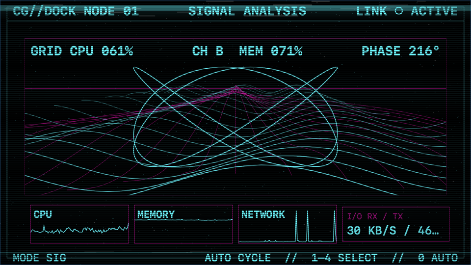
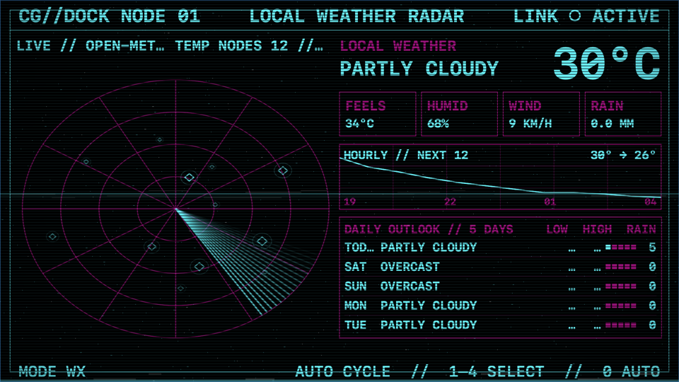
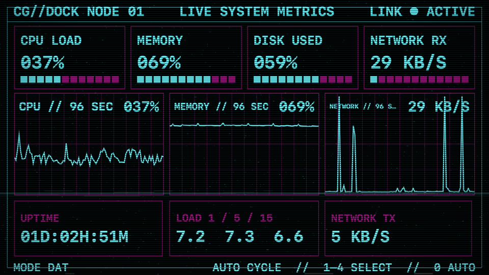

# Retrolemetry

Retrolemetry turns a secondary Mac display into a native, animated system console. Its composition is designed at 960×540, then scales proportionally to Mac, iPad/Sidecar, phone-landscape, and custom display sizes without distorting the layout. It stays out of the Dock and uses SwiftUI and AppKit—no Electron.







## Features

### Live console

- CPU, memory, disk, network, load average, and uptime telemetry, plus optional GPU utilization and battery power/voltage
- Four views: Market Watch, Weather, Signal Analysis, and Live System Metrics
- A dedicated live stock-market screen with a rotating globe, separate world clocks, two five-symbol ticker boards, a click-to-cycle Today/Week/Month/Year focus chart, and a compact USD→ILS reference-rate history
- Green-phosphor and synthwave themes, plus adjustable bloom, scan bands, noise, vignette, and dual VHS tracking lines
- 30 fps animation by default, with 15/60 fps options in Settings; only moving elements refresh rapidly, and hidden or sleeping output pauses animation
- Native Metal renders steady-scene vectors and moving CRT effects independently of the text/data UI; hidden output does not render scenes. Layout previews stay static and scene transitions retain their existing appearance.
- Optional GPU-rendered CRT tube curvature with adjustable strength across every live scene
- Local conditions, a 12-hour temperature/precipitation forecast, a configurable 3–7-day outlook, and click-to-cycle weather radar targets

### Dedicated-display behavior

- Borderless output with Match Display, common Mac/iPad/phone-landscape presets, and custom dimensions
- Automatically chooses the smallest external display, or remembers a display selected in Settings
- Returns to that display after reconnection
- Waits hidden when an explicitly selected display is disconnected instead of falling back to the main Mac display
- Can cover the menu bar on the dock display without changing the main display

### Customization and control

- Optional automatic scene cycling, configurable scene order and interval, horizontal mouse-wheel navigation, and selectable Pan, Diagonal Wipe, or Sync Roll transitions
- Keys `1`–`4` select a scene; `0` or `A` resumes automatic cycling
- Visual layout editor with drag, resize, visibility, five typography groups, and per-view reset controls
- Scene tabs in Settings and typography adjustment up to 300% (text fits within each saved module's available space)
- Radar and globe aspect-ratio calibration on their corresponding layout-editor pages
- Editable Finnhub watch symbols with a Keychain-protected personal API key
- Three configurable market-panel world clocks with automatic daylight-saving changes
- Click a ticker row to hold that stock in the focus chart; click the same row again to resume automatic stock rotation. Clicking the large chart still cycles its timeframe.
- The globe includes continent coastlines, a pulsing marker using the existing approximate weather location, and weekday-session lights for US, European, and Asian regions. These lights are clock-based, not a feed: holidays, early closes, and extended trading are not included.
- Typography groups are Metrics/Stats, Dark texts (all dim, less-phosphorescent text, including titles and labels), Main text (bright labels, stock symbols, weather days/conditions), Frame header, and Frame footer. “Apply to all views” shares the controls; uncheck it to edit just the selected view. Existing three-slider values and exported layouts retain their appearance until a new group is adjusted.
- Static layout previews can show the same CRT curvature/effects as the live screen; hidden modules have no remaining selection outline.
- Optional animated synthwave perspective grid in Signal Analysis, with selectable patterns and CPU, GPU, network, or disk response
- Signal Analysis can show the spinning signal or a live 96-second GPU graph above the grid horizon
- Settings export, menu-bar controls, Launch at Login, a `SIGUSR1` automation toggle, and one-gesture horizontal scene navigation that ignores momentum reversals

GPU utilization is read through public IOKit functions from optional graphics-driver counters. It reports the busiest exposed GPU on multi-GPU Macs; driver support can vary with hardware and macOS versions. Unsupported readings show N/A and gaps in the graph, never CPU/system load masquerading as GPU activity. Battery voltage and electrical flow (voltage × current) use optional IOPowerSources/exported battery properties; the displayed wattage is **battery flow, not CPU/GPU or total Mac power consumption**. No privileged helper, password, private sensor connection, or external process is needed for these readings. Temperature sensors remain unavailable.

Live System Metrics includes separately movable GPU, power/voltage, and GPU-history modules. Hand-arranged older layouts keep every saved frame and start these new modules hidden to prevent overlaps. Enable them in the layout editor, or reset that view to use the expanded six-tile/four-graph default.

## Requirements

- macOS 14 Sonoma or later
- Any macOS-visible secondary display. Match Display is recommended; iPad works through Sidecar, while an iPhone requires third-party software that exposes it to macOS as an external display.
- Apple silicon or Intel, depending on the architecture included in the downloaded release

## Install from GitHub Releases

The first public download is still in preparation. The following steps apply once v1.0.0 appears on the Releases page; source builds are available now.

1. Download the latest `Retrolemetry-*.zip` from [GitHub Releases](https://github.com/SamSpring/Retrolemetry/releases).
2. Unzip it and move `Retrolemetry.app` to `/Applications`.
3. Open Retrolemetry. Grant location access only if you want local weather.
4. Use the waveform icon in the menu bar to choose the dock display and adjust Settings.

The public release will provide a universal app for Apple silicon and Intel, a Developer ID signature, Apple notarization, and a ZIP checksum. Local builds use an ad-hoc signature by default and are not notarized.

## Build from source

Open `Package.swift` in Xcode and run the `Retrolemetry` executable, or use Terminal:

```sh
swift run Retrolemetry
```

To produce a standard app bundle and zip in `build/` and `dist/`:

```sh
./scripts/package_app.sh
```

Use a matching Swift 6 or later compiler and macOS SDK. Packaging requires full Xcode with its Metal tools. The packaging script applies an ad-hoc signature unless `CODESIGN_IDENTITY` is set to a Developer ID Application identity. Sparkle 2.10.0 is pinned in `Package.swift` and `Package.resolved`; the initial source build downloads its official Swift Package artifact.

Packaging converts the approved transparent `Resources/AppIcon.png` into all standard and Retina macOS icon sizes. The app icon combines phosphor green on the left and synthwave cyan/magenta on the right; the menu-bar waveform stays monochrome.

Packaging also compiles the CRT curvature shader with Xcode's Metal tools. If a recent Xcode installation reports a missing Metal Toolchain, install that free component with `xcodebuild -downloadComponent MetalToolchain`. A raw source run enables curvature when a compiled `default.metallib` is available beside the executable; packaging a native build puts it there automatically.

## Controls and automation

- `1`–`4`: select a scene
- `0` or `A`: resume automatic cycling
- Horizontal mouse wheel: move between scenes
- Double-click anywhere on the live console: pause/resume the slideshow without changing the selected stock or radar mode. Horizontal navigation remains available while paused.
- Menu-bar waveform: show/hide, toggle synthwave colors, move display, open Settings, or quit
- `⌘⇧D` toggles the console and `⌘⇧S` toggles synthwave while Retrolemetry is active

For BetterTouchTool, add a **Run Shell Script / Task** action:

```sh
killall -USR1 Retrolemetry
```

The signal hides the console to reveal the content underneath, or restores it to the preferred display. The process remains running, so the response is immediate.

To bind synthwave switching in BetterTouchTool, use a second **Run Shell Script / Task** action:

```sh
killall -USR2 Retrolemetry
```

## Display setup and Launch at Login

Retrolemetry starts as a menu-bar accessory app and centers its proportionally scaled console on the selected display. If no display is selected, it chooses the smallest connected external display. You can turn off menu-bar covering or change the target in Settings.

**Launch Retrolemetry at login** uses Apple's `SMAppService.mainApp`. It is intended for an installed `.app` bundle in `/Applications`; it is not available when running the raw Swift Package executable from Terminal.

## Updates

Choose **Check for Updates…** from Retrolemetry's menu-bar menu (or Settings → Updates). [Sparkle 2](https://sparkle-project.org/) downloads the update, verifies it, installs it and relaunches the app. Updates preserve the existing preference domain, saved layouts, Keychain credentials and login-item identity. Settings also lets you opt in or out of automatic update checks.

The dedicated HTTPS update feed is `https://samspring.github.io/Retrolemetry/appcast.xml`. Both the feed and update archives must carry Retrolemetry's own Ed25519 signature; archives are verified before extraction. No system profile, weather location, stock symbols or API key is attached to update requests. GitHub receives ordinary web requests (including the network address and Sparkle's app/version user agent). Source-run executables do not start the updater.

Before the first public release, the feed is prepared but not deployed. A source-built app's public update check can therefore report a connection error until Publisher deploys the validated feed. This is not a claim that v1.0.0 is available.

## Privacy and weather

Retrolemetry has no accounts, analytics, advertising, or bundled tracking SDKs. System telemetry is read and displayed locally.

Personal-location weather is optional. When location access is allowed, Core Location provides an approximate coordinate and Retrolemetry sends that coordinate to the [Open-Meteo](https://open-meteo.com/) forecast API over HTTPS. The app does not include a weather API key and does not store a location history. Denying location access leaves local weather and automatic region selection unavailable; system telemetry and a manually selected regional map still work.

The weather scan supports Israel, North America and Europe. **Automatic (location)** is the default: a local coverage test chooses a supported map from the existing approximate weather location, without reverse-geocoding or requesting new permissions. Outside those coverage areas, or without a location, choose a manual region in Settings → Weather forecast or Layout Editor → Weather → Map region. Manual selection changes only the map and its representative forecast points, not the personal-location hourly/daily forecast. Israel retains Tel Aviv-Yafo's city outline; other regions do not display it.

Six fixed public locations in the selected region are queried together through [Open-Meteo's forecast API](https://open-meteo.com/en/docs) every 15 minutes. North America samples Seattle, Los Angeles, Chicago, New York, Toronto and Mexico City; Europe samples London, Paris, Berlin, Madrid, Rome and Warsaw; Israel samples North, Haifa, Tel Aviv, Jerusalem, Beer Sheva and Eilat. These are representative points, not a continuous weather field. Region switches cancel outdated requests and never attach one region's forecasts to another map. Click the radar to cycle current-hour rain probability, temperature, wind speed/direction, and explicitly decorative contacts. Arrows show wind flow. These are weather-model forecasts, **not live precipitation radar or observed storm locations**. Missing readings show N/A; markers disappear when the retained forecast is over an hour old.

Map artwork is deliberately simplified and is not a boundary or navigation authority. The country outline uses Natural Earth's public-domain 50m admin-0 default de facto dataset. The Tel Aviv coordinate ring in `RadarMapData.swift` is separate data licensed under [OpenStreetMap's ODbL](https://www.openstreetmap.org/copyright), © OpenStreetMap contributors, from [relation 1382494](https://www.openstreetmap.org/relation/1382494). That city dataset remains ODbL; the application code remains MIT. Map attribution is also displayed inside the radar.

Live market data is also optional. Retrolemetry sends only the configured ticker symbols directly to Finnhub and stores the user's personal Finnhub API key in macOS Keychain. The key is never written to preferences, exported settings, source control, or release archives. Focus-chart requests send only the selected ticker symbol to Yahoo's public, no-login chart endpoint; Retrolemetry never connects to a Yahoo account or portfolio. The USD→ILS panel requests public daily reference-rate history from [Frankfurter](https://frankfurter.dev/) and is explicitly labeled as daily data, not a live trading quote. Quotes are informational and are not trading advice.

## Support

If Retrolemetry is useful to you, you can [support future development on Ko-fi](https://ko-fi.com/samspring).

Bug reports and focused feature requests are welcome in [GitHub Issues](https://github.com/SamSpring/Retrolemetry/issues).

## Development

Small, behavior-preserving fixes are welcome. See [CONTRIBUTING.md](CONTRIBUTING.md). Maintainers can find signing, notarization, and release packaging steps in [RELEASING.md](RELEASING.md).

Retrolemetry's application code is available under the [MIT License](LICENSE). [NOTICE.txt](NOTICE.txt) records the separate Sparkle and map-data notices, which are also included in the packaged app.

The bundled continent outlines are simplified public-domain [Natural Earth](https://www.naturalearthdata.com/about/terms-of-use/) 110m land data. They are display artwork, not a boundary or navigation map. The offline weekday lights follow core sessions documented by [NYSE](https://www.nyse.com/trade/trading-information), [London Stock Exchange](https://docs.londonstockexchange.com/sites/default/files/documents/servicetechnicaldescriptionintroductionofnewtradingcurrencies.pdf), [Xetra](https://www.xetra.com/xetra-en/trading/trading-calendar-and-trading-hours), [Japan Exchange Group](https://www.jpx.co.jp/english/equities/trading/domestic/01.html), and [HKEX](https://www.hkex.com.hk/Services/Trading-hours-and-Severe-Weather-Arrangements/Trading-Hours/Securities-Market?sc_lang=en). Region lighting is approximate and is not trading advice or a live market-status indication.
